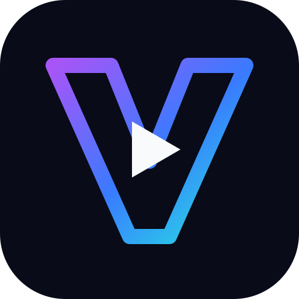

# VYRALIS Studio

<p align="center"></p>
<h1 align="center">VYRALIS STUDIO</h1>
<p align="center"><strong>Every moment has a story.</strong></p>
<p align="center">A creator studio for turning long-form footage into reviewed, polished short-form video.</p>

## Public website

The marketing site lives at `/` and the working studio at `/studio` (the workspace routes such as `/create`, `/projects` and `/review/:projectId` are unchanged). Both are served by the same Vite React app, so `npm run dev` gives you the site and the product together.

The design direction is the warm "Creativity in Motion" system: cream paper, deep violet type, coral accents and soft 3D forms. It replaced the monochrome brutalist alternative because it carries the VYRALIS identity, matches the violet brand mark in the studio, and reads as a video/creator product instead of a generic agency template.

Site copy is deliberately tied to the feature registry: surfaces are labelled *Live* only when the local pipeline supports them end to end, and everything else remains *Planned*. The landing page does not display invented metrics, reach estimates or provider connections.

Design tokens, routes and copy guidance: [docs/website.md](docs/website.md).

## Main product workflow

Import a video → analyse speech and moments → review ranked clips → edit → export MP4 → package for social platforms → approve and publish → learn from real performance.

The primary product is the working video clipping and production workflow. StoryLab, trend intelligence, workflow automation, growth tools, publishing and analytics are part of the wider product scope, but they must not be represented as connected until their integrations and end-to-end tests exist.

## Current working foundation

The repository contains a React 18 + TypeScript + Vite studio UI and a FastAPI local processing API.

The implemented local vertical slice currently supports:
1. Upload local MP4, MOV, MKV, WebM or AVI media, or paste an eligible public YouTube, Twitch or Kick video link.
2. Stream local uploads to storage, or ingest a supported provider URL in a background job; validate the resulting media using FFprobe.
3. Create a project and persist a processing job in SQLite.
4. Extract mono 16 kHz audio with FFmpeg.
5. Transcribe speech with faster-whisper, including segment and word timestamps.
6. Build transcript-window clip candidates with an explainable heuristic score breakdown.
7. Review candidate previews, transcripts and timecodes.
8. Edit clip start/end and title.
9. Render H.264/AAC MP4 at 9:16, 1:1 or 16:9 with FFmpeg.
10. Inspect every render automatically (duration, frame size, codecs, black frames, frozen frames, loudness) and block downloads that fail.
11. Validate packaging copy per destination, approve a package, and download the approved file for manual upload.
12. Cancel queued or running jobs at worker checkpoints, with retries and idempotent export requests.
13. Recover queued/processing jobs after worker restart using the local SQLite job records.
14. Import a YouTube, Twitch or Kick **link** with yt-dlp (rights attestation required, host allowlist, duration/size caps), then run the same transcribe → rank → render pipeline.
15. Burn word-timed captions into the MP4 in three styles (clean, karaoke sweep, impact), with an optional hook line on its own top layer; download matching SRT, VTT and ASS sidecars.
16. Reframe to the export preset with a centre crop, a blurred-fill layout, or face-tracked cropping when the optional vision extra is installed.
17. Show exactly what was burned in — captions, style, hook, layout and whether tracking actually ran — inside the render quality report.
18. Connect YouTube, TikTok, Instagram and X through each platform's real OAuth 2.0 flow (PKCE where supported), with encrypted token storage, automatic refresh, honest "not configured" states and one-click disconnect.
19. Read each connected account's live public numbers (subscribers, followers, views, posts) and show them beside studio counts that come straight from the database — no sample analytics anywhere.

Link ingestion uses yt-dlp extractors for eligible public sources; it does not use account cookies, DRM bypass or private/paywalled access. A source may still be unavailable because of provider restrictions, regional/age limits or extractor changes. Users must have permission and comply with the source platform's terms. The candidate score is a transparent transcript heuristic. It is not a trained virality model and does not predict reach. The current API is a single-workspace local foundation, not a secure multi-user hosted service.

## Full product scope

The complete feature inventory, current implementation status and acceptance gates are in [docs/feature-registry.md](docs/feature-registry.md).

Architecture and service boundaries: [docs/architecture.md](docs/architecture.md).

Upstream research — which open-source clippers and components are worth using, and which are licence traps: [docs/upstream-evaluation.md](docs/upstream-evaluation.md).

Target API contract: [docs/api-contract.md](docs/api-contract.md). This is a target contract; routes are not implemented merely because they are documented.

Link ingestion behaviour, safeguards and limits: [docs/source-ingestion.md](docs/source-ingestion.md).

Connecting social accounts (exact redirect URIs, scopes and app-review realities): [docs/oauth-setup.md](docs/oauth-setup.md).

Security, privacy and media-rights requirements: [docs/security-and-privacy.md](docs/security-and-privacy.md).

Local and hosted deployment guidance: [docs/deployment-runbook.md](docs/deployment-runbook.md).

Implementation sequence: [docs/roadmap.md](docs/roadmap.md).

## Product areas

- Core clipper and review pipeline
- Analysis intelligence and explainable highlight ranking
- Professional editor, captions, reframing and brand kits
- Repurposing and social publishing
- Analytics and creator growth intelligence
- Trend and niche research
- StoryLab and storyboard planning
- Visual workflow automation
- Accounts, workspaces, collaboration and operations

These areas are not all implemented. Each feature must be connected to a real service, persistence layer, provider and tests before it is marked available.

## Local development

Requirements: Python 3.11, Node.js 20+, FFmpeg and FFprobe, and `yt-dlp` if you want to import links.

FFmpeg must be built with **libass** for burned-in captions (`ffmpeg -filters | grep subtitles`). Distro packages, Termux's `ffmpeg` package and the usual static builds include it. Without libass, the render fails loudly with the FFmpeg error instead of producing a video with no captions.

Backend:

```bash
python -m venv .venv
source .venv/bin/activate
pip install -r backend/requirements.txt   # includes yt-dlp for link imports
# optional: face-tracked framing instead of centre crops
pip install opencv-python-headless
VYRALIS_DATA_DIR=./data uvicorn backend.app.main:app --reload --host 127.0.0.1 --port 8000
```

On Android/Termux the same steps work with `pkg install python nodejs ffmpeg yt-dlp`, then `python -m venv` and the commands above. Use the smallest whisper model your device can run (`VYRALIS_WHISPER_MODEL=small` or `base`).

Frontend, in a second terminal:

```bash
npm install
npm run dev
```

The Vite dev and preview servers proxy `/api` to `http://127.0.0.1:8000`, so the browser stays on one origin and no CORS setup is needed. Point the proxy elsewhere with `VYRALIS_API_TARGET`, or set `VITE_API_BASE_URL` if the API is on another host.

For the full test suite (including the HTTP surface tests, which need `httpx`), install `backend/requirements-dev.txt` instead and run `python -m unittest discover -s tests`. Tests that need FFmpeg skip themselves when it is absent.

The first faster-whisper run downloads the configured model. Configure VYRALIS_WHISPER_MODEL, VYRALIS_WHISPER_DEVICE and VYRALIS_WHISPER_COMPUTE for the available hardware.

## Deploying to Render

One Render service is enough. The multi-stage `Dockerfile` builds the Vite studio, then the
Python engine, which serves that build from the same origin — so API calls need no CORS, OAuth
callbacks and downloads share one host, and the optional access gate covers the whole app.
`render.yaml` adds a 20 GB persistent disk at `/var/lib/vyralis`, a health check on
`/api/health` and a readiness probe on `/api/ready`.

Before making it public, set `VYRALIS_AUTH_SECRET` (token encryption, generated by the
blueprint) and `VYRALIS_BASIC_AUTH` (`user:password`). `vercel.json` is included if you prefer
a CDN split — but then Basic auth cannot work, because browsers do not prompt for credentials
on cross-origin API calls. Full sequence: [docs/deployment-runbook.md](docs/deployment-runbook.md).

## Deployment boundary

The root Dockerfile builds the FastAPI processing API only; it does not build or serve the React frontend. Use separate frontend and API/worker deployments. Mount persistent storage for local SQLite and media. Do not expose the current unauthenticated single-workspace API publicly as a multi-user service. Hosted release requires authentication, tenant isolation, PostgreSQL migrations, a durable queue, private object storage and the controls in docs/security-and-privacy.md.

## Product principles

- Real workflows over demo screens.
- Creator approval and manual control over generated edits.
- Evidence-backed recommendations, not fake virality promises.
- Official, authorized platform integrations only.
- Local processing where practical, with explicit disclosure for third-party processing.
- Respect source, music, voice, likeness and generated-asset rights.
- No fake metrics, simulated publishing or dead controls.
